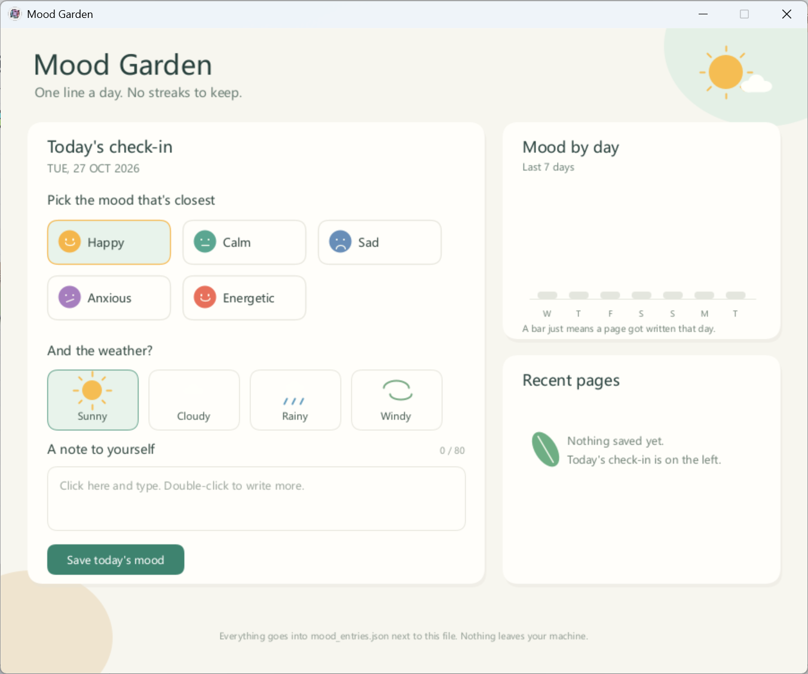
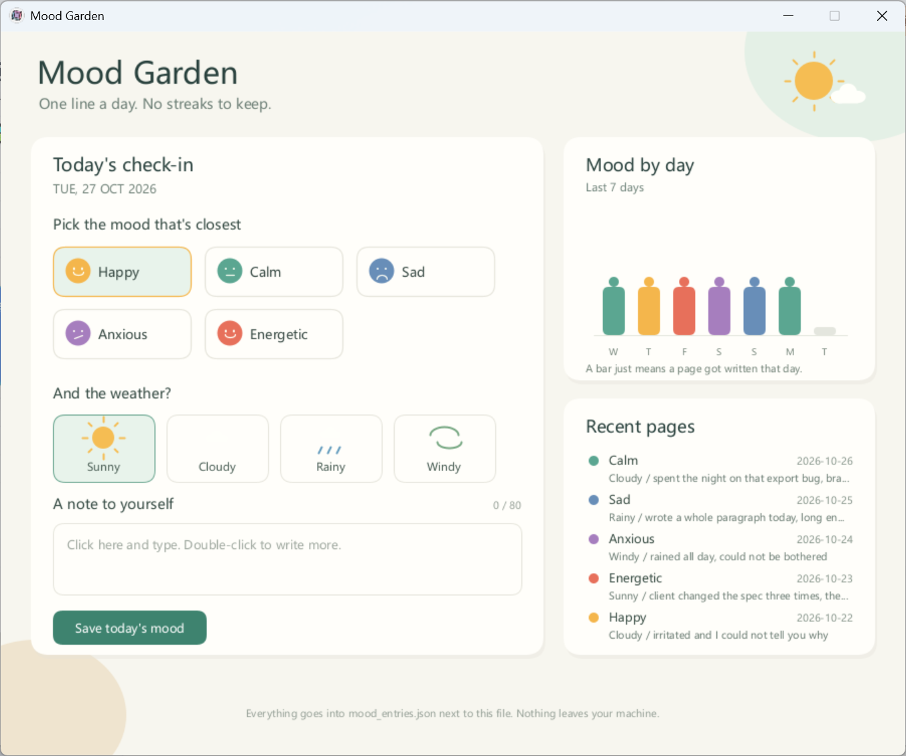
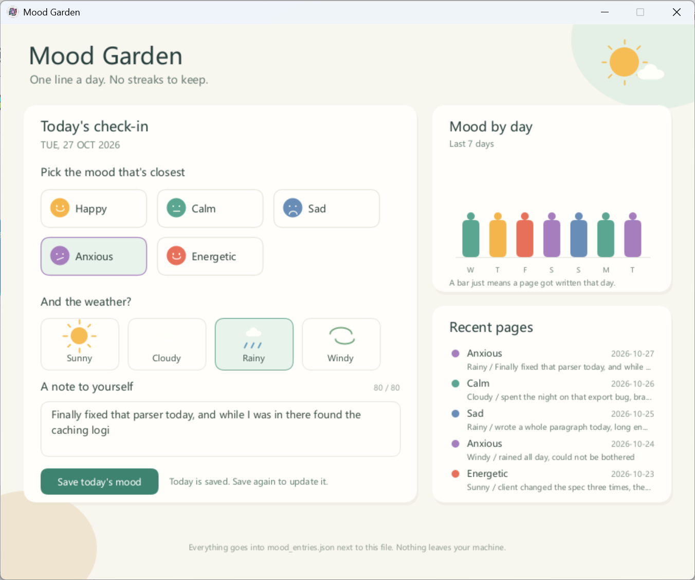

# Mood Garden

Pick a mood, pick the weather, write a line or two, hit save. That's it.



It writes to a local json file. Nothing goes over the network. One entry per day;
saving twice on the same day updates that day's entry instead of adding a second one.
Close it and open it again and today's entry comes back into the box, ready to edit.

## Two versions

This started out as Processing Python Mode. Later I needed it to pop up a window when
you hit Run in PyCharm, so I copied it over to py5.

```
processing-python/MoodGarden/MoodGarden.pyde   runs in Processing
py5-version/mood_garden.py                     runs in PyCharm
```

Before I started the copy I assumed it would be a rewrite. Most of it turned out to be
renamed functions, `textWidth` becoming `text_width` and so on. 36 of the 39 functions
map one to one. The other three are py5's own house rules: `size` and `smooth` have to
go in `settings()`, and putting them in `setup()` is an immediate error.

So why not just one file? I tried. Put an environment check at the top, leave the body
alone, both sides run. But the result reads badly. The first fifty lines work out where
they are, then there's `if _IN_PROCESSING` scattered through the middle, and Jython
habits (`u""` prefixes, hand-rolled utf-8) sit next to Python 3 code in the same file.
I split them. The cost is fixing a bug in two places, and missing one doesn't show up
right away. When I touch the interface I look at both.

## Running it in Processing

1. Install [Processing 4](https://processing.org/download)
2. Mode dropdown in the top right, `Add Mode...`, install Python Mode
3. `File → Open`, pick `processing-python/MoodGarden/MoodGarden.pyde`
4. Hit play in the top left

A `.pyde` only runs in Processing. Hand it to a normal Python interpreter and you get no
error and exit code 0, and no window: the file is just `def setup()` and `def draw()`
with nothing calling them, and `size()`, `rect()`, `mouseX` are injected by Processing,
which a plain interpreter doesn't do.

I hit this in PyCharm. The console said `Process finished with exit code 0`, which looks
like a successful run. Nothing had been drawn.

## Running it in PyCharm

```bash
pip install -r py5-version/requirements.txt
```

py5 finds the JDK through `JAVA_HOME`. Having `java` on PATH does nothing for it.
Without it you get:

```
py5 is unable to start a Java 17 Virtual Machine
```

Which sounds like a missing DLL but is really "can't find `%JAVA_HOME%\bin\server\jvm.dll`".
Set it:

```cmd
setx JAVA_HOME "C:\Program Files\Eclipse Adoptium\jdk-25.0.3.9-hotspot"
```

Swap in your own path. Reopen your terminal and PyCharm afterwards; `setx` doesn't
affect windows that are already open.

The docs say JDK 17. I'm on Temurin 25 and it runs fine, window and all.

Then `File → Open` the `mood-garden` folder, right-click `mood_garden.py`, Run. Pick the
right interpreter and that's all. No Run Configuration needed.

## Using it

Click a mood card, click a weather card. Click the text box and type. 80 characters max,
anything past that is dropped. Press `Save today's mood` and both cards on the right
update right away.

Double-click the text box to get a system input dialog. That's how you write something
longer. In the Processing version it's the only way, for the reason under "Known issues".

After a few days of saving, the right side looks like this:



## Data

`mood_entries.json`, next to the script:

```json
[
  {
    "date": "2026-10-26",
    "mood": "Calm",
    "weather": "Cloudy",
    "note": "spent the night on that export bug, brain is mush"
  }
]
```

Plain text you can read, not `\u4eca\u5929` style escapes. The file is in `.gitignore`
and never gets committed.

Breaking it by hand won't crash anything. If it can't be read, you get a line of text
next to the button and it carries on with empty data.

## What I changed

The original had a few spots that look fine and aren't. A sample:

- Press Shift or an arrow key and an invisible character goes into the box, the counter
  goes up, and the json saves a box glyph. The check is `key >= " "`, and special keys
  come through as `chr(65535)`.
- Wrapping measured with the wrong font size. `textSize` was still 10 from the counter
  label, so lines were measured at 10 and drawn at 13, and the text ran out the bottom
  of the box. The result is cached, so it stayed wrong.
- The last line of `mousePressed` overwrote whatever state had just been set, so clicking
  a mood or a weather card did nothing.
- Recent entries were truncated by character count. One Chinese character is two Latin
  widths; 38 of them burst the card.
- `last_click_at` starts at 0 and `millis()` is near 0 on startup, so a click on the text
  box within the first 350 ms counted as a double-click.

The Processing one also has a Jython 2.7 encoding problem. The default codec is ascii, so
`open(path, "w")` and `str(chinese_text)` both raise `UnicodeEncodeError`. It's a binary
write with manual utf-8 now.

## Known issues

The Processing version can't type Chinese. With an IME, typing pinyin puts Latin letters
in the box, because its keyboard callback receives physical key presses and knows nothing
about what the IME composed. This is a Processing limitation rather than a bug in the
sketch, which is why there's a double-click dialog. That one is a Swing component and
the IME works there. The py5 version doesn't have the problem.

Fill a long note back in through the dialog and it fits in three lines:



And a few others:

- Dates come from the system clock. Changing the clock scrambles "one entry per day".
- Bar heights in `Mood by day` are hard-coded. A bar means that day got written, nothing
  about how strong the mood was. Doing intensity properly means adding a 1 to 5 field to
  the data. I didn't, a few more radio buttons aren't worth it.
- The window is a fixed 900×720 and ignores system scaling. Following scaling means
  recalculating every coordinate, which isn't worth it either.

## License

MIT
